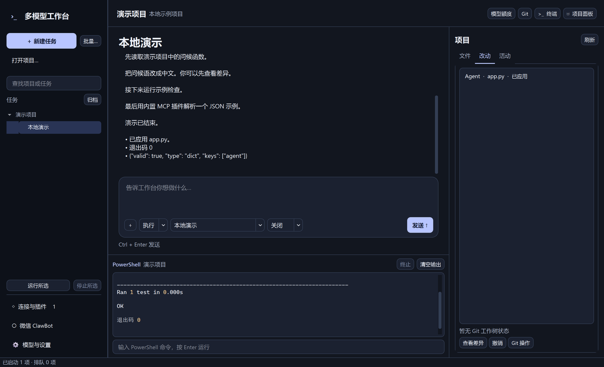

# 多模型工作台

Windows 桌面编程 Agent。打开一个项目后，你可以让模型读代码、提出文件改动、运行测试，再切到另一家模型继续同一个任务。



## 启动

1. 从 [GitHub 最新发布](https://github.com/Joey766/multi-model-workbench/releases/latest) 下载 **MultiModelAgent.exe**，双击启动。EXE 已包含应用运行时，可直接在 Windows x64 上运行。
2. 左侧按项目分组管理任务，支持搜索、置顶、重命名和归档。右键任务打开菜单。
3. 想先试用，点 **试用离线演示**。示例会读代码、显示修改差异、运行示例检查，再调用内置 JSON 检查插件。批准每一步即可走完全程。
4. 正式使用时，在 **模型与设置** 中保存至少一家 Key，等工作台自动读取模型列表，再选择项目文件夹和模型。

## 桌面工作流

- **执行、计划、问答** 在输入框底部切换。执行模式可提议修改、命令或插件调用，均可逐项审批。计划模式可读取项目。问答模式使用对话和你主动附加的内容。
- **文件与差异** 右侧可预览 UTF‑8 文件、附加项目文件和 AGENTS.md、看双栏差异、查工具日志和撤销 Agent 改动。输入框的加号可以添加图片或粘贴截图，适用于 GPT、Gemini、Claude 和 DeepSeek Flash。
- **同项目多任务** 点「批量…」，一行一个任务，可创建草稿或立即运行。在左侧按 Ctrl 或 Shift 多选，再点「运行所选」或「停止所选」。可以切到别的任务查看对话、工具活动或审批。任务前的标记会区分运行、待审批和排队。
- **并行和排队** 计划或问答可以与同一目录的执行任务同时运行。多个任务要在同一目录执行时，后提交的任务会排队，等目录空闲后自动开始。退出工作台时，排队任务会保留为草稿。
- **Git** 从顶部的 Git 菜单创建独立工作树，同一项目的工作树任务会归在原项目组内，且可并行修改。工作树从当前 HEAD 创建，未提交的改动留在当前目录。右侧改动页可以查看 Git 差异、暂存、取消暂存和创建本地提交。
- **PowerShell** 顶部的终端按钮打开项目命令区。在当前项目目录逐条执行，保留本次会话的命令历史和输出。
- **快捷键** Ctrl+O 打开项目，Ctrl+N 新建任务，Ctrl+K 搜任务，Ctrl+Enter 发送。深色和浅色外观可在「模型与设置」切换。

## 模型

| 提供商 | 两款预置模型 | 推理档位 |
| --- | --- | --- |
| OpenAI | GPT‑6.2 Astra、GPT‑6.2 Sol | 低、中、高、超高、最高 |
| Google Gemini | Gemini 4 Carbon、Gemini 4 Neon | Carbon 低至高，Neon 低至超高 |
| Anthropic Claude | Claude Fable 5.2、Claude Opus 5.5 | 低、中、高、超高、最高 |
| DeepSeek | DeepSeek V4 Pro、DeepSeek V4.1 Flash | 关闭、低、高、最高 |

保存 Key 或打开工作台时，会使用当前 Key 从四家供应商的官方列表接口获取模型。返回的兼容文本模型会更新到任务选择器、连接测试和模型额度。供应商新增模型后，也可以点 **刷新模型** 手动更新。发现过程只读取列表。

读取失败时，显示同一 Key 最近一次成功读取的列表，或暂时显示上表中的预设。更换 Key 后会重新读取。如果任务原选的模型从新列表中消失，会保留任务和对话，并提示重新选模型。推理档位以已知能力和返回的模型信息为准。仅显示「默认」时由 API 决定推理设置。

具体模型能否生成，还取决于 Key 的推理权限、账户余额及限额。**测试连接**会发送一条真实的短请求，可能产生少量 API 费用。

API Key 由供应商的开发者平台签发。符合条件的 ChatGPT Pro 或 Business 可以绑定 API 账户领取额度。Gemini API 有自己的 API 项目和计费设置。Key 在 Windows 下用 DPAPI 加密后保存在本机，也可用进程环境变量 OPENAI_API_KEY、GEMINI_API_KEY、ANTHROPIC_API_KEY、DEEPSEEK_API_KEY。本机保存的 Key 优先。

顶部「模型额度」可查看所选模型本次启动后的最近 API 响应。供应商提供时显示剩余请求、Token、重置时间和建议重试时间。DeepSeek 可直接查询 API 账户余额。Gemini 的实时项目限额，以及其他供应商未返回的限制，通过相应的官方限额或账单入口查看。会员套餐的 5 小时和周额度在会员客户端单独查看。

- [OpenAI 模型目录](https://developers.openai.com/api/docs/models) · [ChatGPT API 额度](https://developers.openai.com/api/docs/guides/chatgpt-api-credits)
- [Gemini 模型目录](https://aistudio.google.com/docs/models) · [Gemini API 计费](https://aistudio.google.com/docs/billing)
- [Claude 模型目录](https://platform.claude.com/docs/en/models/overview)
- [DeepSeek 模型和计费](https://api-docs.deepseek.com/quick_start/pricing/)

## 在同一个任务里切换

在输入框下方选模型和推理强度，下次发送时生效。工作台会把近期可见对话和当前任务改过的文件名交给新模型。换供应商时，发送前会请你确认。新模型也可按需重新读取项目文件。普通项目的文字指令、发送给模型的代码和工具结果，会按任务交给所选 API 供应商。模型的私有推理块仅在当前轮用于接续工具调用。

文件改动先显示差异。批准后写入，任务结束后可从 **文件改动** 查看和撤销。撤销前会核对磁盘内容，避免覆盖你之后手动改过的版本。命令和 MCP 工具调用也逐次审批。命令用当前账户权限运行，右侧 **活动** 会保留输出。停止会结束本机的工具流程，供应商仍可能对已经发出的请求计费。

## MCP 插件

在 **MCP 插件 → 插件预设** 中，选择服务并点 **启用并连接**。应用下次启动时会恢复已启用的连接。

| 插件 | 使用方式 |
| --- | --- |
| 内置文本工具 | 开箱可用，提供 JSON 检查和文本统计 |
| Microsoft Learn、DeepWiki | 默认启用，搜索微软文档或查询公开仓库 |
| Context7 | 默认启用，可填 Context7 API Key |
| GitHub | 填自己的访问令牌。预设仅开放只读仓库、Issue 和 PR 工具 |
| Figma Desktop | 在 Figma 的 Dev Mode 打开桌面 MCP，再回工作台启用 |
| Playwright | 选择启用后通过 npm 获取微软官方 MCP，并使用独立的 Edge 测试会话 |
| Outlook | 使用本机经典 Outlook 已配置的默认收件箱，支持只读搜索和查看正文，每次由你批准 |
| 小红书 | 可填写你已有授权的 MCP 地址；官方账号授权需要应用审核 |

GitHub 和 Context7 在预设中输入的凭证会用 DPAPI 加密。插件管理页显示连接状态和发现的工具。可以在 **自定义 MCP** 中粘贴 mcpServers 配置，保存后立即连接。配置里的 command 会启动本机程序，建议使用你信任的来源。

~~~json
{
  "mcpServers": {
    "my-local-tool": {
      "enabled": false,
      "command": "C:\\Tools\\my-mcp.exe",
      "args": [],
      "env": { "TOKEN": "${MY_LOCAL_MCP_TOKEN}" }
    },
    "my-http-tool": {
      "enabled": false,
      "url": "https://your-service.example/mcp",
      "headers": { "Authorization": "Bearer ${MY_HTTP_MCP_TOKEN}" }
    }
  }
}
~~~

把示例地址替换成实际地址并设为 true。自定义插件的令牌可从启动前设置的环境变量读取。支持 stdio 和 Streamable HTTP 的同步工具调用。远程插件可使用匿名访问或认证请求头，交互式 OAuth 和异步 MCP 任务暂未实现。 [MCP 规范](https://modelcontextprotocol.io/specification/2026-07-28)

Outlook 使用本机 Outlook 对象模型，批准读取后，工具结果会交给本轮所选模型。小红书官方公开的账号授权范围为基础资料。 [Outlook 官方接口](https://learn.microsoft.com/en-us/office/vba/api/outlook.namespace.getdefaultfolder) · [小红书官方接入文档](https://openaccount.xiaohongshu.com/docs/quick-start)

## 绑定自己的微信

1. 点左侧 **微信 ClawBot → 生成微信二维码**，用手机微信扫码并授权。手机如有绑定 PIN 提示，可在应用窗口输入。
2. 连接后，在手机的 **微信 ClawBot** 对话中发一条文字，消息会进入桌面端收件箱。
3. 选中消息并点 **带入任务草稿**，选择本地项目、模型和强度，确认后发送给模型。也可以点 **写回复**，编辑后发回自己的 ClawBot 对话。

只处理扫码账户发送给这个 ClawBot 的私聊文字。桌面应用需运行才能收取新消息。授权凭证和收件箱在本机加密保存。需要撤销微信端授权时，可在手机的 ClawBot 管理页面断开。 [腾讯微信接入协议](https://github.com/Tencent/openclaw-weixin/blob/main/docs/protocol_zh_CN.md)

## 本机数据

默认数据位置是 %LOCALAPPDATA%\MultiModelAgent。历史任务、文件差异和插件配置保存在此处。桌面版沿用同一路径下的 API Key 和任务记录，界面直接调用本地引擎。当前版本处理文字任务和 UTF‑8 项目文件。

可用启动参数 --data-dir 指定独立数据目录。若长时间处于模型处理中，可用 **测试连接** 核对 Key、模型权限和额度。

## 从源码运行和打包

在 Windows x64 上安装 Python 3.14 和 Git。从仓库根目录运行以下 PowerShell 命令。

```powershell
py -3.14 -m venv .venv
.\.venv\Scripts\python.exe -m pip install -r requirements.txt
.\.venv\Scripts\python.exe src\qt_workbench.py
```

运行回归测试和打包命令。模型调用测试使用模拟响应，MCP 测试使用本机回环服务。

```powershell
.\.venv\Scripts\python.exe tests\smoke_agent.py
.\.venv\Scripts\python.exe tests\smoke_qt.py
.\.venv\Scripts\python.exe -m PyInstaller --noconfirm MultiModelAgent.spec
```

打包输出为 `dist\MultiModelAgent.exe`。
